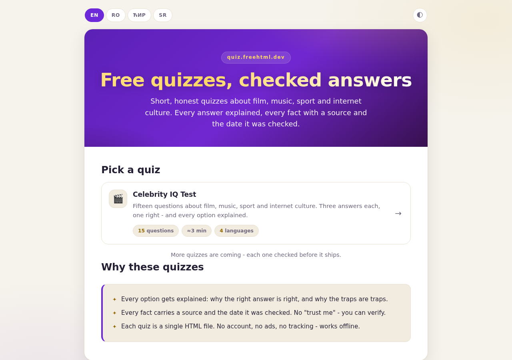
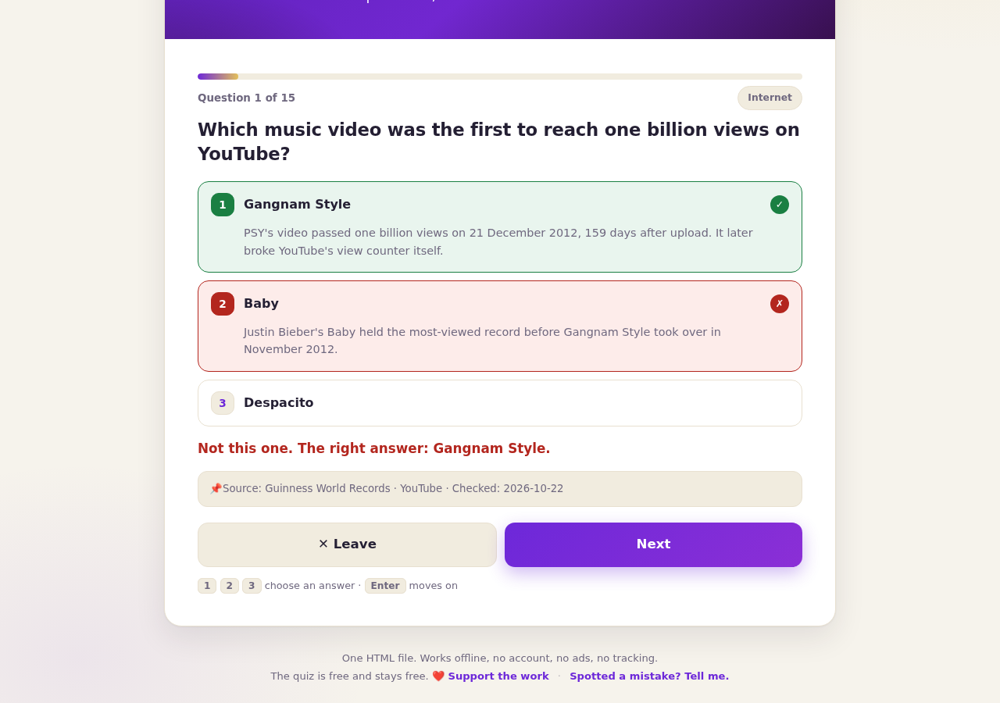
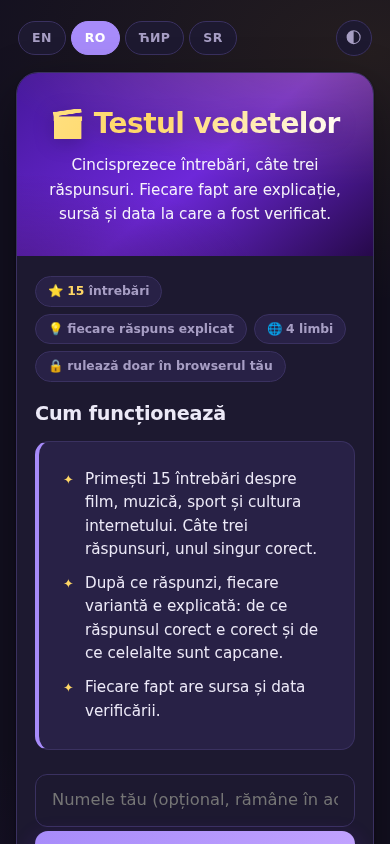

# Quizzes

**Short, honest quizzes with checked answers: every option explained, every fact with a source and the date it was checked.**

[](https://tekideki.github.io/quizzes/)
[](LICENSE)



This repository holds the hub and the quizzes. The hub lists what is ready to play; every quiz is a single HTML file that runs entirely in the browser, served from the hub's own address, so the language and the theme chosen on the hub carry into the quiz.

No account, no upload, no tracking, no advertising. One HTML file per quiz, and it works offline.

## What is here

| Quiz | Questions | Languages |
| --- | --- | --- |
| [Celebrity IQ Test](celebrity-iq-test/) | 15 | English, Romanian, Serbian Cyrillic, Serbian Latin |

## What every quiz here guarantees

- **Three answers, one right, all of them explained.** After you answer, every option carries its reason: why the right one is right, and why the traps are traps.
- **A source and a date on every fact.** The line under each question says where the fact comes from and when it was checked. That is the honest version of "accurate": a source, a date and a way to report a mistake.
- **Four languages, properly translated.** Not only the buttons: the questions, the explanations and the titles. The Serbian Cyrillic and Latin texts are checked letter by letter against each other, because the two scripts are a perfect transliteration of one another and must never drift.
- **Light and dark, phone first.** One tap switches the theme; the layout is checked from 360 px up, with tap targets of a comfortable size.



- **One file, zero dependencies.** No build, no CDN, no fonts fetched from elsewhere. Saved locally, the quiz opens and works offline.
- **A quiet support line.** Free, and it stays free; a single discreet link in the footer.

## How the hub and the quizzes cooperate

Both live on the same origin, so they share one `localStorage` key. Choose Romanian or the dark theme on the hub, and any quiz opens the same way; change it inside a quiz, and the hub follows on the way back. Nothing leaves the browser.



## Tests

```bash
node tests/check_sr.js index.html                     # the hub: 18 Serbian pairs
node tests/check_sr.js celebrity-iq-test/index.html   # the quiz: 156 Serbian pairs
python3 tests/test_quiz.py celebrity-iq-test/index.html
python3 tests/test_hub.py index.html celebrity-iq-test/index.html
```

`check_sr.js` transliterates the Serbian Cyrillic of every string into Latin and compares it with the Latin text written by hand; any drift, any stray Cyrillic letter in the Latin text, or a Latin paste in the Cyrillic one stops the check.

The browser suites play the quiz and the hub in Chromium: a full 15/15 round with the marks on the options, a wrong answer with the verdict, the source and the explanations, the keyboard, the theme kept after reload, the settings shared between hub and quiz, the footer links, the layout from 360 to 1366 px, and zero console errors. They need Python 3, Playwright and Chromium (`pip install playwright && python3 -m playwright install chromium`).

## Adding a quiz

1. Write it to the house format: fifteen questions, three options each, every option explained, a source and a checked date on every fact, all four languages.
2. Drop it in a folder (`my-quiz/index.html`), add a row to `var QUIZZES` in the hub and the two strings (`q2t`, `q2d`) in all four locales.
3. Run the tests above, all of them green, before publishing.

## License

Apache 2.0. The questions are written for this project; the sources named next to them belong to their authors.

Every tool here is free and stays free, with no account, no ads and no tracking. If you want to support the work, [paypal.me/TekiDeki](https://paypal.me/TekiDeki) is in the footer of every page.
